# 基于WebGIS的露天矿山生态修复遥感监测与综合评价系统

面向露天矿山生态修复的 WebGIS 前端，提供从遥感指标计算、专题图层发布、多年度综合评价到结果验证的完整流程。

## 功能模块

| 模块 | 说明 |
|---|---|
| 监测大屏 | 矿区得分排名、年度趋势、修复等级分布、指标均值、地图着色 |
| 矿区查看 | 按年份/数据源/矿区裁剪并发布影像图层，支持高程、坡度、坡向计算 |
| 评价指标计算 | FVC 植被覆盖度、VRI 植被恢复指数、NDMI 土壤湿度、NDSI 裸土指数、RSEI 遥感生态指数 |
| 矿区生态修复效果评估 | 指标录入、权重加权、综合得分与修复等级、年度对比图表 |
| 评估结果验证 | 结果自洽性核查、等级面积与年际转移、权重与阈值敏感性分析 |
| 专题图展示 | 评价结果专题图浏览 |
| 用户管理 | 账号与角色管理（自助注册固定为普通用户，管理员可提权） |

## 技术栈

- Vue 2.5 + Vue Router + Vuex
- Element UI 2.x
- Leaflet + GeoServer WMS
- ECharts 5
- webpack 3 + Babel 6

## 运行环境

| 依赖 | 版本/地址 |
|---|---|
| Node.js | 16.x（项目使用 webpack 3，不建议 Node 17+） |
| 后端服务 | Flask，默认 `http://localhost:5001` |
| 地图服务 | GeoServer，默认 `http://localhost:8081/geoserver` |

> 本仓库仅包含前端代码。指标计算、栅格处理、GeoServer 发布由独立的后端服务提供，需另行部署后才能完整运行。

## 本地启动

```bash
npm install
npm run dev
```

默认访问 `http://localhost:8080`。

生产构建：

```bash
npm run build
```

产物输出到 `dist/`（已在 `.gitignore` 中忽略）。

## 运行截图

### 监测大屏

按年份与数据源查看矿区得分排名、年度趋势、修复等级分布与指标均值，地图按修复等级着色。

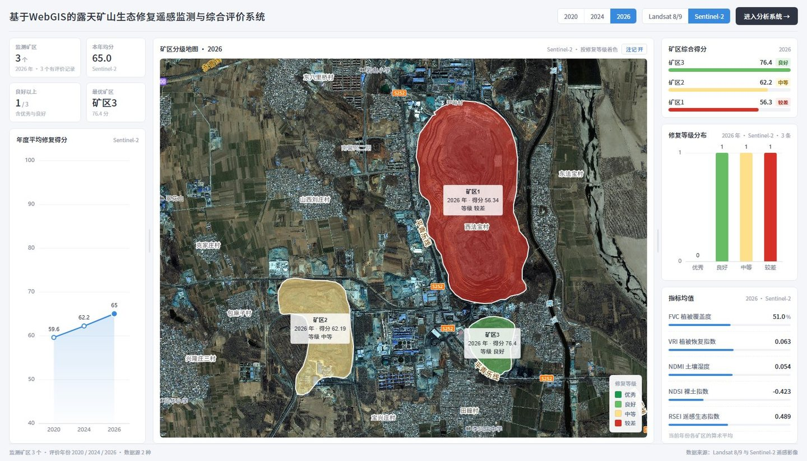

### 矿区查看

按年份、数据源、矿区裁剪并发布遥感影像，支持高程、坡度、坡向计算。下图为三个矿区 2026 年 Sentinel-2 影像同时发布后的效果。

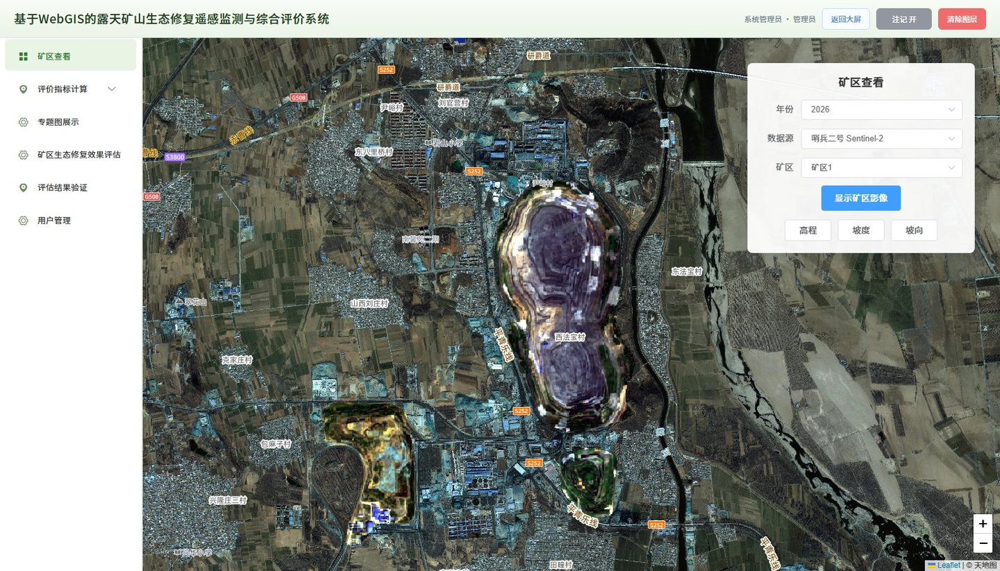

基于 DEM 派生地形因子，支持高程、坡度、坡向计算，三个矿区可同时叠加显示：

| 高程 | 坡度 |
|---|---|
| 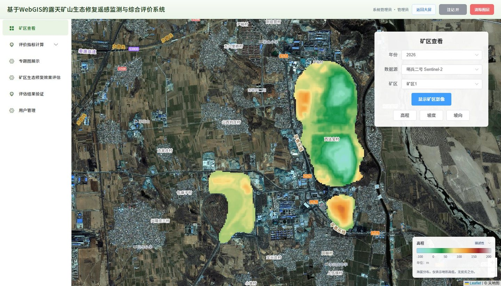 | 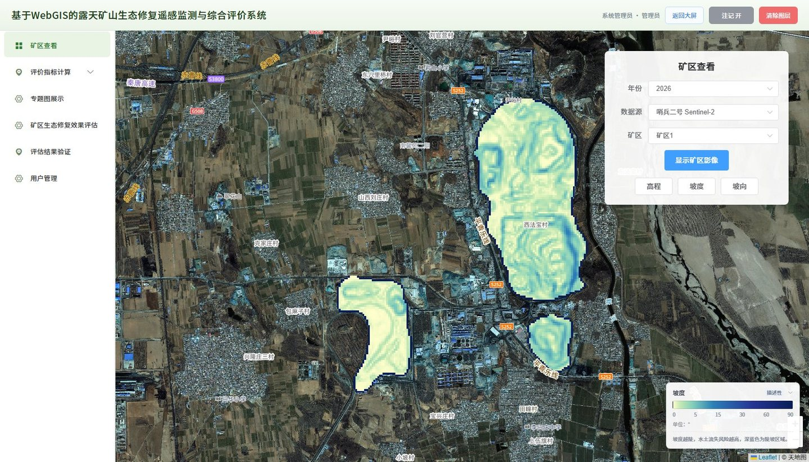 |

坡向：

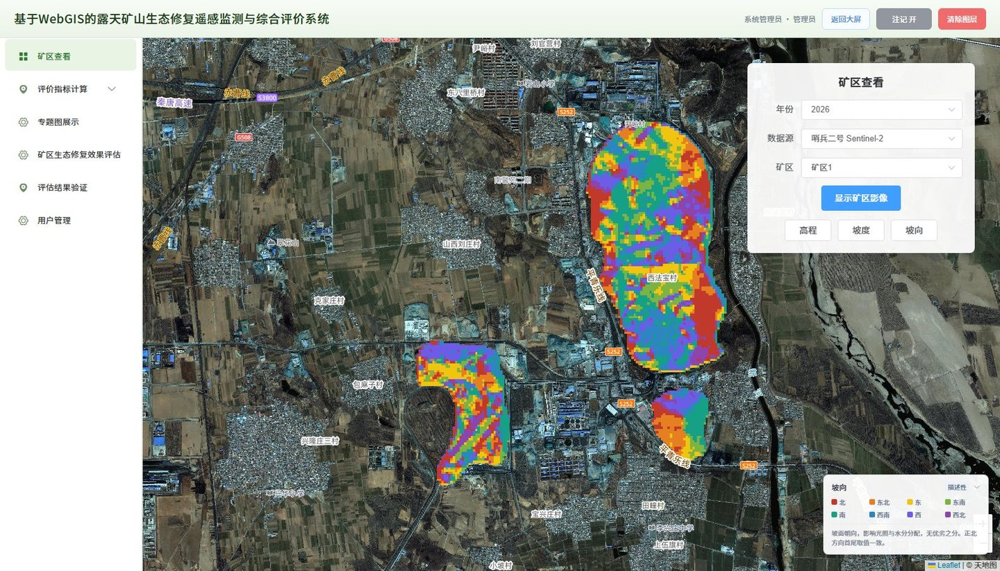

### 评价指标计算

五个指标页面布局一致，均包含数据源、矿区、年份选择与计算按钮。下图为三个矿区分别按 2026 年 Sentinel-2 计算后同屏叠加的结果（FVC 为例）：

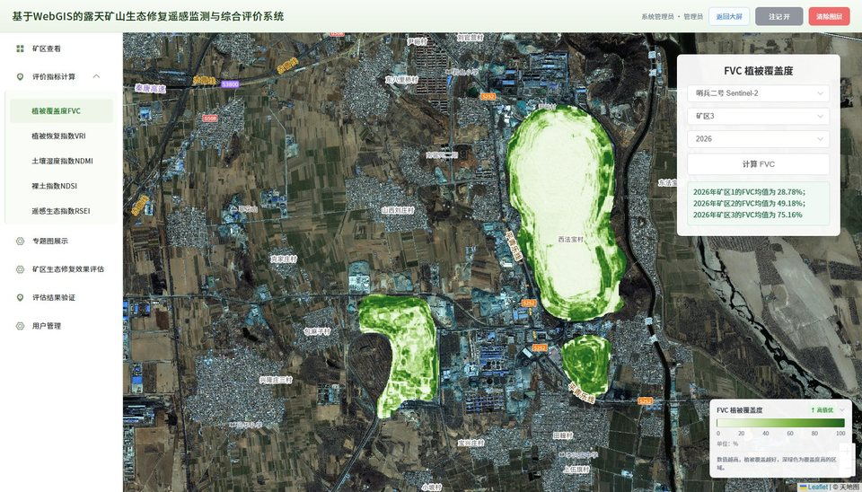

| 植被恢复指数 VRI | 土壤湿度指数 NDMI |
|---|---|
| 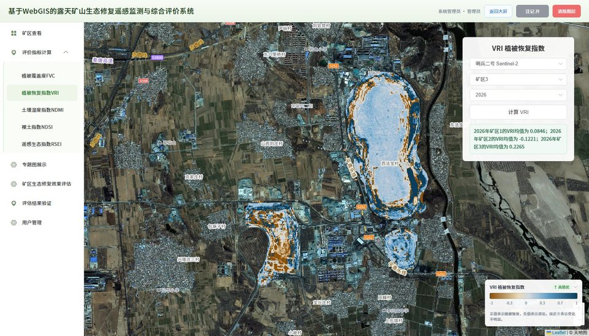 | 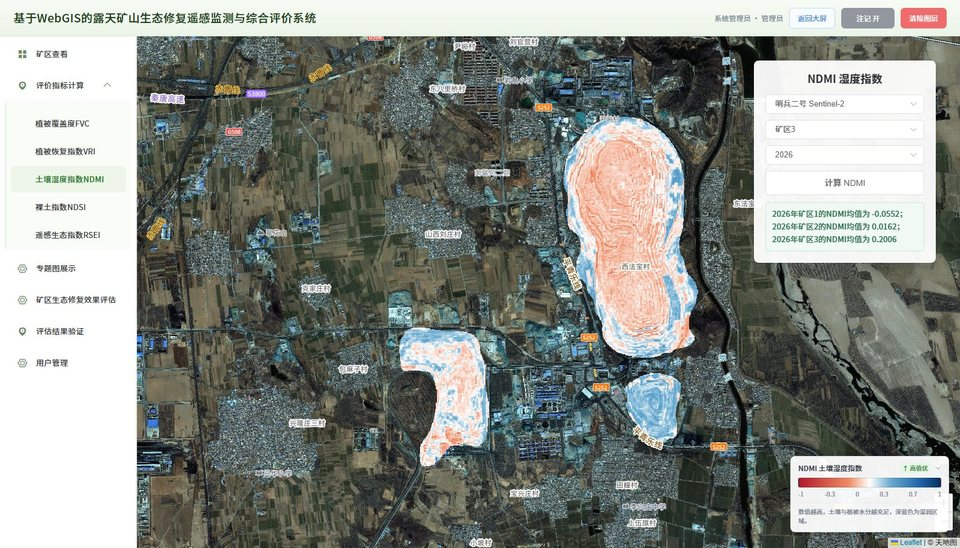 |

| 裸土指数 NDSI | 遥感生态指数 RSEI |
|---|---|
| 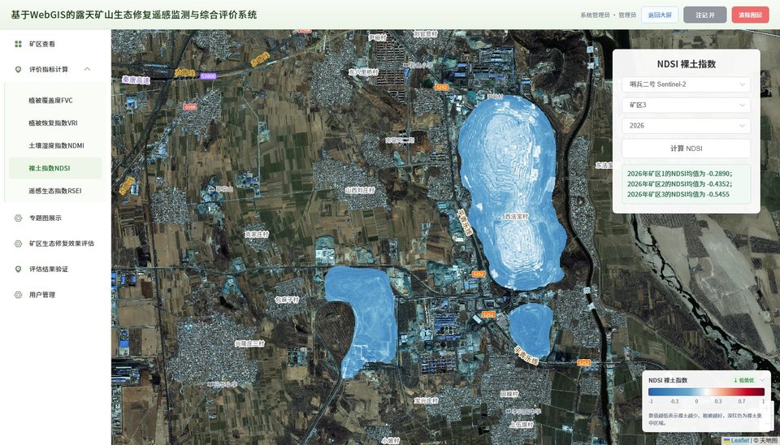 | 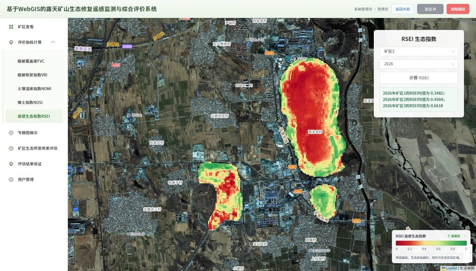 |

> RSEI 依赖 Landsat 8/9 波段组合，因此该指标使用 2026 年 Landsat 数据计算，其余四项默认支持 Sentinel-2。

### 专题图展示

按矿区与指标分组浏览已生成的专题图，当前共 75 张。

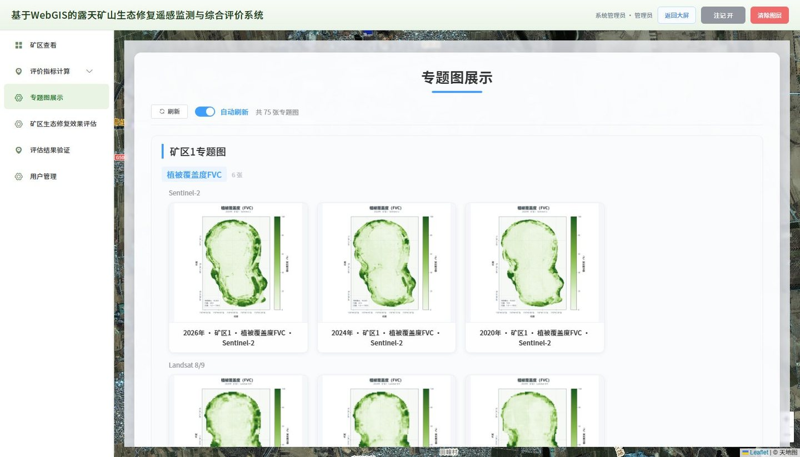

### 矿区生态修复效果评估

按矿区与数据源管理评价记录，展示五项指标、环境协调性、土壤污染、年份、修复等级与综合得分。

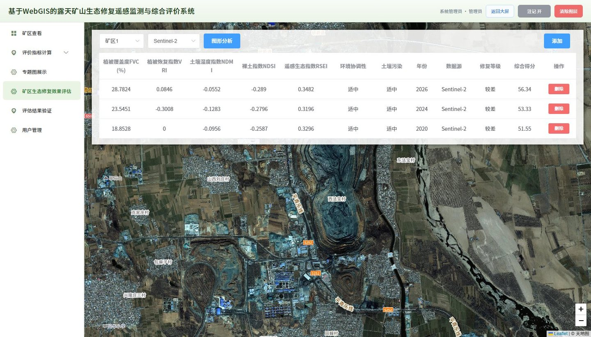

点击「添加」录入评价指标、权重、环境协调性、土壤污染与评价年份：

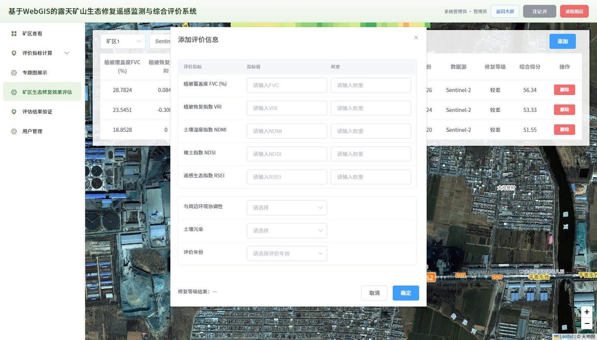

点击「图形分析」后，在表格下方展开指标年度变化曲线与生态评估等级柱状图：

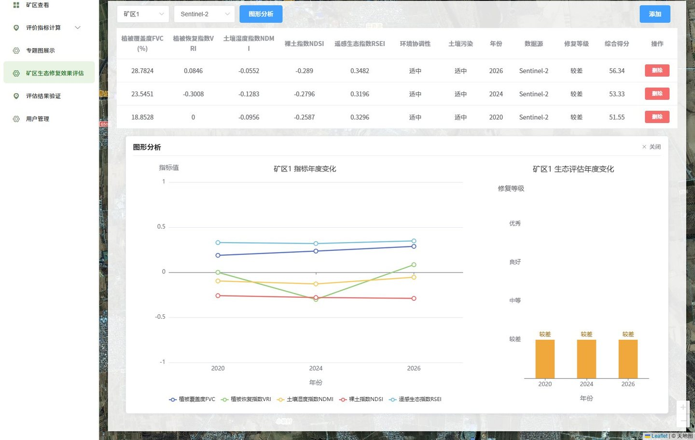

### 评估结果验证

对评价结果做自洽性核查、等级面积与年际转移统计、权重与阈值敏感性分析。

「结果自洽性」标签：核查权重和、指标取值范围、得分与等级、年际趋势，并给出指标贡献分解。

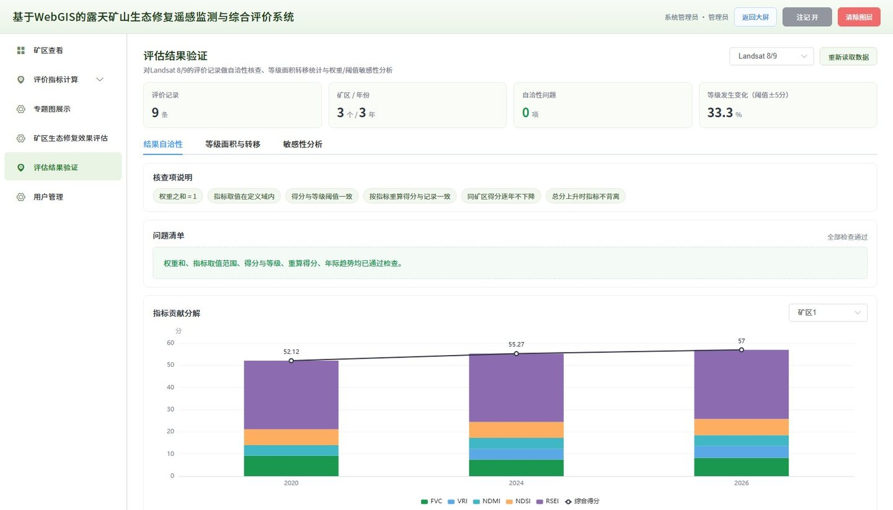

「等级面积与转移」标签：各等级面积统计与年际等级转移明细。

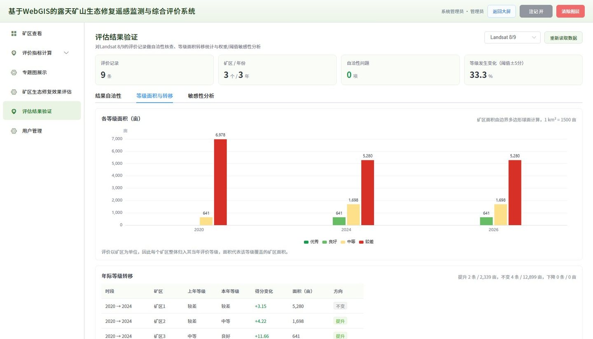

「敏感性分析」标签：单指标权重上下浮动 20%、分级阈值整体平移后的等级变化与检验结论。

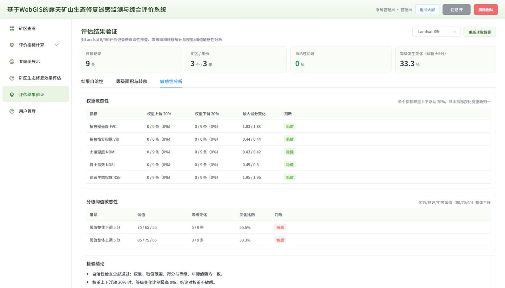

### 用户管理

管理系统账号、角色与启用状态；自助注册账号固定为普通用户，管理员可调整角色。

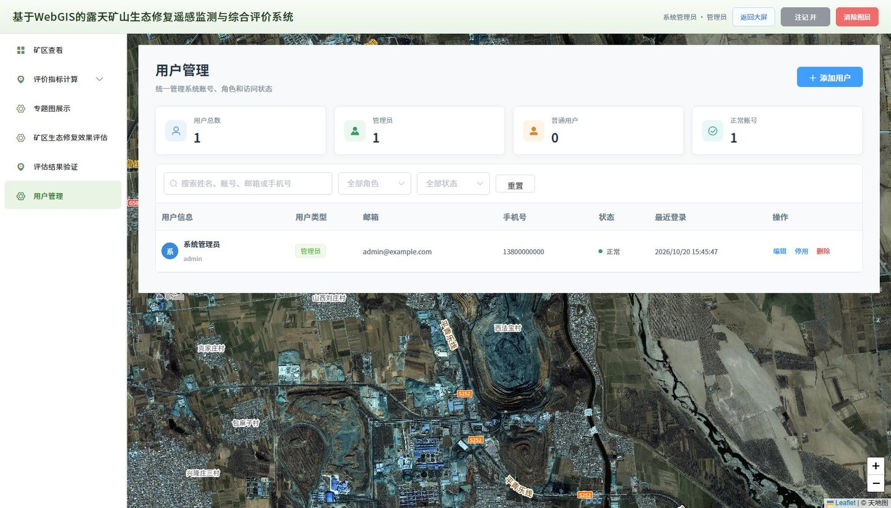

## 许可证

本项目采用 [MIT License](LICENSE) 开源，可自由使用、修改与分发，保留版权声明即可。

## 问题交流

使用中遇到问题或有改进建议，欢迎交流：

- QQ：**3123937191**（或者私信我）
